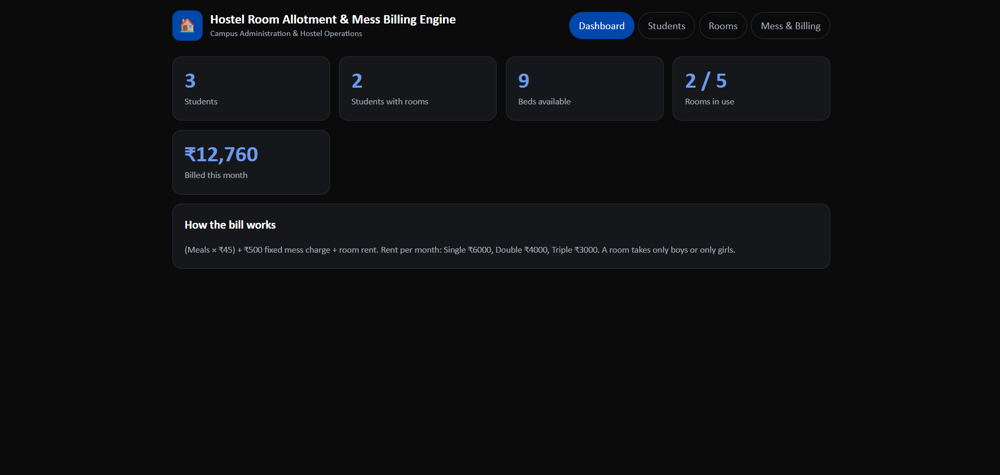
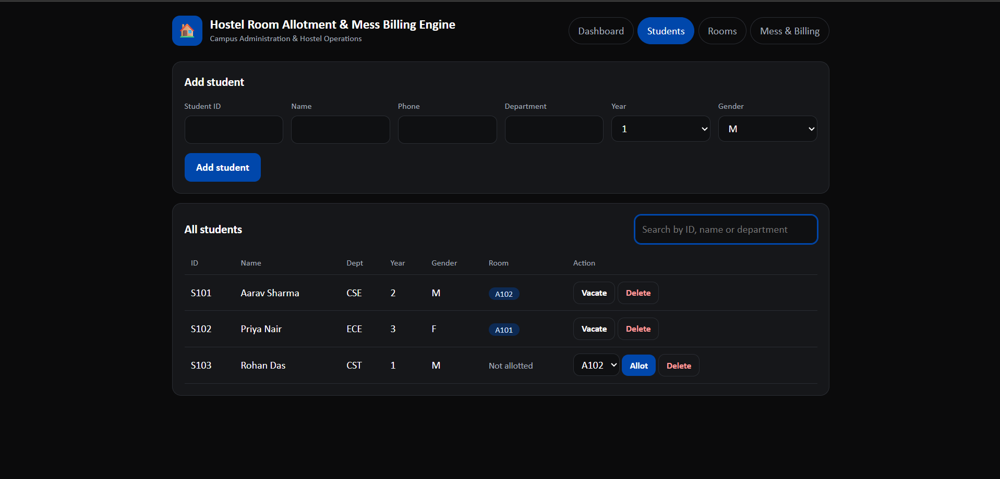
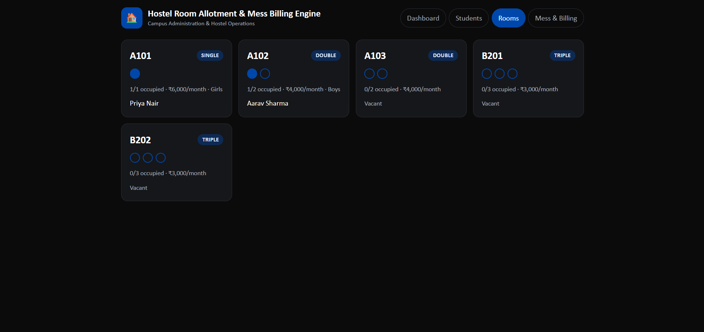
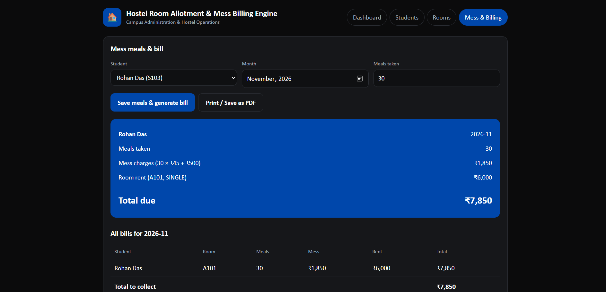

# 🏠 Hostel Room Allotment & Mess Billing Engine

### A Web-Based Hostel Management System

A simple and efficient web application designed to manage hostel student registration, room allocation, occupancy tracking and monthly mess billing.

🌐 **Live Demo:** [Visit Hostel Management System](https://mithunreddy0575-cmd.github.io/Hostel-Room-Allotment/)

💻 **Source Code:** [GitHub Repository](https://github.com/mithunreddy0575-cmd/Hostel-Room-Allotment)

---

## 📌 Project Overview

The Hostel Room Allotment & Mess Billing Engine is a browser-based application developed using HTML, CSS and JavaScript.

The application simplifies hostel administration by providing student management, automated room allotment, room availability monitoring and monthly mess bill generation through a single dashboard.

---

## 📸 Project Screenshots

### 1. Dashboard

Displays total students, students with rooms, available beds, room occupancy and monthly billing statistics.



### 2. Student Management

Add new students, manage student details, search records and delete student information.



### 3. Room Management

Monitor room availability, occupancy and room-sharing capacity.



### 4. Mess & Billing Management

Record monthly meals, calculate individual student bills and view the total amount to collect.



---

## ✨ Key Features

* 👨‍🎓 Student registration and management.
* 🔍 Search students by ID, name or department.
* 🏠 Single, Double and Triple room allocation.
* 🚻 Separate room allocation for boys and girls.
* 🛏️ Automatic room capacity management.
* 📊 Dashboard with live hostel statistics.
* 🍽️ Monthly meal recording.
* 💰 Automatic mess bill calculation.
* 🧾 Individual student bill generation.
* 📄 Print bills or save them as PDF.
* 💾 Browser-based data storage using LocalStorage.

---

## 🛠️ Technologies Used

| Technology   | Application                |
| ------------ | -------------------------- |
| HTML5        | Website structure          |
| CSS3         | User interface and styling |
| JavaScript   | Application functionality  |
| LocalStorage | Browser-based data storage |
| GitHub       | Source code management     |
| GitHub Pages | Website deployment         |

---

## 💵 Mess Billing Calculation

The application automatically calculates the monthly hostel bill.

**Billing Formula:**

Total Bill = (Meals × ₹45) + ₹500 + Room Rent

### Room Rent Details

| Room Type      | Monthly Rent |
| -------------- | -----------: |
| Single Sharing |       ₹6,000 |
| Double Sharing |       ₹4,000 |
| Triple Sharing |       ₹3,000 |

Fixed Mess Charge: ₹500 per month.

Meal Charge: ₹45 per meal.

---

## 📂 Project Structure

```text
Hostel-Room-Allotment/
│
├── index.html
├── style.css
├── script.js
├── README.md
│
├── dashboard.png
├── students.png
├── rooms.png
└── mess-billing.png
```

---

## 🚀 How to Run the Project

1. Clone or download this repository.
2. Open the project folder in Visual Studio Code.
3. Open `index.html` in your browser.
4. Alternatively, use the Live Server extension.

No additional installations are required.

---

## 💾 Data Storage

The application uses JavaScript LocalStorage to save student records, room allocation and monthly meal information.

**Note:** Data is stored in the browser where the application is used. It is not synchronized between different users or devices.

---

## 🔮 Future Enhancements

* Admin and student login authentication.
* Database integration using Firebase or MySQL.
* Online hostel fee payment.
* Student attendance management.
* Monthly financial reports.
* Hostel complaint management system.
* Centralized data management.

---

## 🎯 Project Objective

To develop a simple and efficient digital solution that reduces manual work in hostel administration and makes student management, room allocation and mess billing easier.

---

⭐ If you find this project interesting, consider giving this repository a star!


